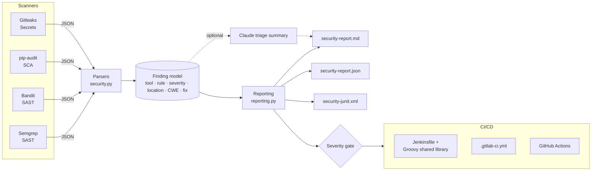

# DevSecOps Agent

[](https://github.com/etichisom/ai-devsecops-agent/actions/workflows/ci.yml)


**A Python CLI and AI agent that runs security scanners (SAST, SCA, secret detection), turns their output into one report, and plugs into Jenkins, GitLab CI and GitHub Actions.**

It works in two modes:

- **Pipeline mode** (`devsecops-agent scan` / `report`): no API key needed. It runs Semgrep, Bandit, pip-audit and Gitleaks, normalises their JSON into one finding model, writes Markdown, JSON and JUnit reports, and fails the build on a severity threshold. If an Anthropic API key is set, Claude adds a short triage summary for developers.
- **Agent mode** (`devsecops-agent chat`): a terminal assistant built on the Claude API with tool use. It can read code, run the scanners, inspect flagged lines, explain the risk and propose fixes, all inside a sandboxed workspace.

---

## Why I built it

Security scanners are easy to add to a pipeline and hard to act on. Each tool has its own output format, severity scale and exit-code rules, and developers end up ignoring a wall of findings. This project covers that gap:

1. **One finding model** for every scanner, so reporting and gating are written once.
2. **CI-native output**: JUnit XML shows findings in the Jenkins/GitLab test UI, and a Markdown report goes in the job summary or MR artifact.
3. **A clear gate**: `--fail-on high` (or `FAILURE` vs `UNSTABLE` in Jenkins) instead of each tool's own exit code.
4. **AI-assisted triage**, used carefully: Claude summarises and ranks the findings, but it never decides whether the build passes.

---

## Architecture



```
src/devsecops_agent/
├── cli.py              # argparse CLI: chat | scan | report, exit codes for CI
├── agent.py            # Claude tool-use loop + one-shot findings triage
├── security.py         # scanner runners + parsers -> Finding model
├── reporting.py        # Markdown / JSON / JUnit reports, severity gate
└── tools/
    ├── base.py         # Tool model + registry (errors go back to the model as is_error results)
    ├── filesystem.py   # read/list/edit, sandboxed to a workspace root
    ├── security_scan.py# exposes the scanners to the agent
    └── video.py        # download a video / split it into frames (OpenCV)
ci/jenkins/
├── vars/securityScan.groovy                         # reusable pipeline step
├── src/io/github/etichisom/devsecops/SecurityGate.groovy  # gate logic (unit-tested)
└── test/SecurityGateTest.groovy
tests/
├── unit/               # parsers, reporting, sandbox, registry
├── integration/        # agent loop with a fake Claude client, CLI end to end
└── fixtures/           # recorded scanner output
```

---

## Quick start

```bash
git clone https://github.com/etichisom/ai-devsecops-agent.git
cd ai-devsecops-agent
python -m venv .venv && source .venv/bin/activate
pip install -e ".[dev,scanners]"
```

**Scan a project** (no API key needed):

```bash
devsecops-agent scan path/to/project --fail-on high
```

```
3 findings (critical=0, high=1, medium=2, low=0, info=0)
  wrote reports/security-report.md
  wrote reports/security-report.json
  wrote reports/security-junit.xml
FAILED: findings at or above 'high'
```

**Merge reports produced by separate CI jobs:**

```bash
devsecops-agent report \
  --semgrep semgrep.json --bandit bandit.json \
  --pip-audit pip-audit.json --gitleaks gitleaks.json \
  --out reports --fail-on high
```

**Chat with the agent:**

```bash
export ANTHROPIC_API_KEY=...        # or copy .env.example to .env and load it
devsecops-agent chat --workspace path/to/project
```

```
you> scan this repo and tell me what to fix first
agent> I ran semgrep, bandit and pip-audit. One issue matters most: app/db.py:27 builds a SQL query
       with an f-string from request data (CWE-89). Use a parameterised query instead...
```

**Run with Docker:**

```bash
docker build -t devsecops-agent .
docker run --rm -v "$PWD:/workspace" devsecops-agent scan . --fail-on high
```

### CLI reference

| Command | What it does | Exit code |
|---|---|---|
| `scan [PATH] -s semgrep,bandit,... --fail-on high --ai-summary` | Runs the scanners and writes reports | `1` if the gate fails, `2` on usage errors |
| `report --semgrep F --bandit F ...` | Builds reports from existing scanner JSON | same |
| `chat -w DIR --model ID` | Interactive agent | `0` |

Missing scanners are reported and skipped instead of crashing the run, so the same command works on a laptop with only Bandit installed and in CI with all four.

---

## CI/CD integration

### Jenkins / CloudBees: Groovy shared library

[`ci/jenkins/vars/securityScan.groovy`](ci/jenkins/vars/securityScan.groovy) is a reusable pipeline step. Any team can call it from their Jenkinsfile:

```groovy
securityScan(
    path: '.',
    scanners: 'semgrep,bandit,pip-audit',
    failOn: 'high',      // build FAILURE
    warnOn: 'medium',    // build UNSTABLE
    aiSummary: true,
    credentialsId: 'anthropic-api-key'
)
```

It runs the scan, archives the reports, publishes the JUnit results and then sets the build result. That gives three outcomes (FAILURE / UNSTABLE / SUCCESS), which a plain exit code can't express. The gate logic is in [`SecurityGate.groovy`](ci/jenkins/src/io/github/etichisom/devsecops/SecurityGate.groovy). It's written without closures so it runs the same way under Jenkins CPS and in plain Groovy unit tests.

The repo's own [`Jenkinsfile`](Jenkinsfile) loads the library from `ci/jenkins` and runs these stages: install → lint → tests (JUnit + coverage) → security scan → CycloneDX SBOM → Docker build → Trivy image scan.

### GitLab CI

[`.gitlab-ci.yml`](.gitlab-ci.yml) runs each scanner as its own parallel job, using upstream images where they exist. Then a `security-report` job merges the results and applies the gate:

| Stage | Jobs |
|---|---|
| lint | `ruff` |
| test | `pytest` on Python 3.10–3.12 (JUnit + Cobertura coverage), `groovy-library` |
| security | `semgrep`, `bandit`, `pip-audit`, `gitleaks` (full history) |
| report | `security-report` (gate + JUnit in the MR widget), `sbom` (CycloneDX report) |
| build | `docker-build`, `container-scan` (Trivy) |

To get an AI summary, set `ANTHROPIC_API_KEY` as a masked CI/CD variable. Without it, the step is skipped.

### GitHub Actions

[`.github/workflows/ci.yml`](.github/workflows/ci.yml) runs the same checks. It writes the Markdown report to the job summary and uploads the reports and SBOM as artifacts. All third-party actions are **pinned to commit SHAs**. The scanner flagged the original version-tag pins in this repo, so I fixed them.

---

## Security design decisions

- **Workspace sandbox:** every file path the model supplies is resolved and must stay inside the workspace root. `../`, absolute paths and symlinks pointing outside are rejected (see [`test_filesystem.py`](tests/unit/test_filesystem.py)).
- **Safe edits:** `edit_file` refuses ambiguous matches and won't overwrite an existing file without an explicit `old_text`.
- **No shell:** scanners run via `subprocess.run` with a fixed argv list and a timeout. User input never reaches a shell.
- **Secrets stay out of reports:** the Gitleaks parser drops the secret value, and Gitleaks runs with `--redact`.
- **Keys come from the environment**, never from code. `.env` is git-ignored and `.env.example` documents the variables.
- **Tool errors go back to the model** as `is_error` tool results, so the agent can recover instead of crashing. The loop also has a hard cap on tool rounds.
- **Downloads** are limited to `http(s)` and 500 MB, and file names are stripped of directory parts.
- **Container** is a multi-stage build that runs as a non-root user and is scanned with Trivy.
- **Reviewed suppressions:** each `# nosec` / `nosemgrep` in the code has a written justification. The repo scans itself clean in CI.

## Testing

```bash
pytest --cov          # 63 tests: unit + integration
ruff check src tests  # lint (includes flake8-bandit security rules)
groovy -cp ci/jenkins/src ci/jenkins/test/SecurityGateTest.groovy
```

- **Unit tests** cover each parser against recorded scanner output, severity normalisation, the report formats, the gate, the sandbox and the tool registry.
- **Integration tests** run the real agent loop and real tools against a scripted fake Claude client. They check tool round-trips, parallel tool calls, error results, refusals and the round limit. The CLI tests go end to end through argument parsing, report files and exit codes.

No test calls the real API, so the suite is fast, free and deterministic in CI.

## Configuration

| Variable | Purpose | Default |
|---|---|---|
| `ANTHROPIC_API_KEY` | Enables `chat` and `--ai-summary` | — |
| `CLAUDE_MODEL` | Model used by the agent | `claude-sonnet-5-5` |

## How I built this

This started as my own prototype: a terminal coding assistant on the Claude API with file and video tools (the first commit in this repo). I then used an AI coding assistant to help turn it into a DevSecOps tool: restructuring it into a package, fixing bugs in the agent loop, adding the scanner integration, tests and CI/CD pipelines.

I reviewed every change, ran the tests and scans myself, and debugged the first CI run (the Groovy job failed because the container's non-root user couldn't write the runner's temp files). The commit history shows each step.

## Roadmap

- SARIF output for GitHub code scanning
- Jira ticket creation for new HIGH/CRITICAL findings, with de-duplication by fingerprint
- Baseline file so only *new* findings fail the build
- DAST stage (OWASP ZAP baseline scan) against a preview environment

## License

MIT
